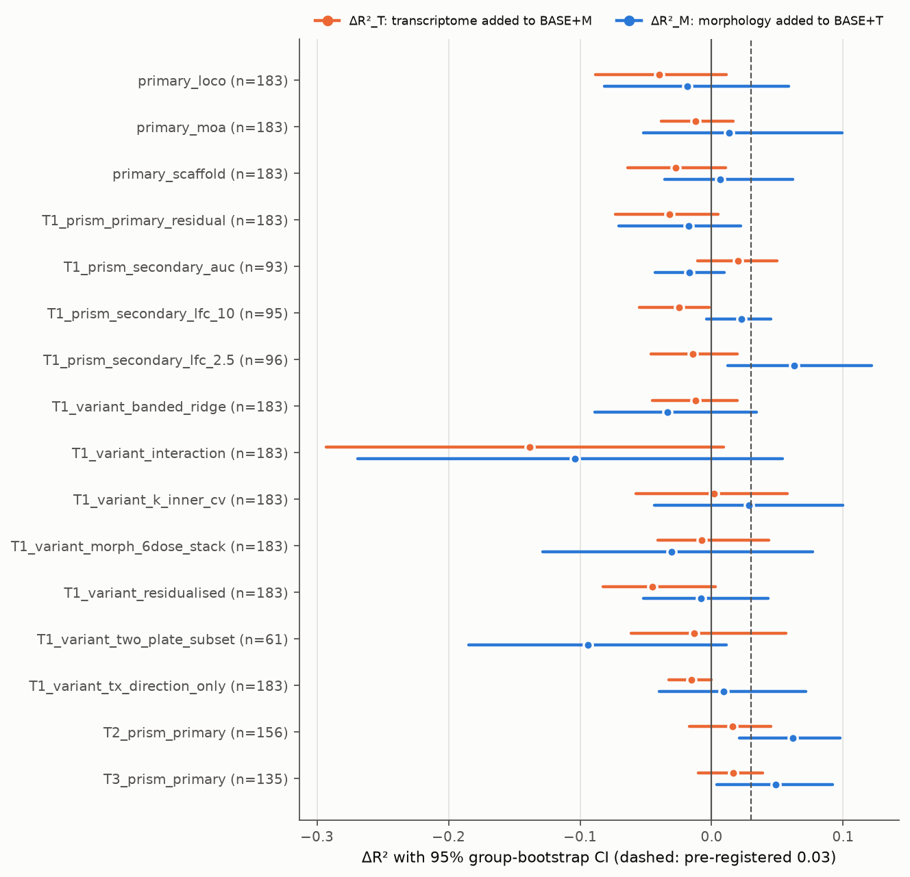

# shapeshift-fusion

Are Cell Painting morphology and Tahoe-100M transcriptomic signatures *jointly* informative about drug sensitivity
(PRISM viability), even though [ShapeShift](https://github.com/Sam-Wo/shapeshift) found they share little
similarity structure?

[](../../actions/workflows/ci.yml)

## Headline: a pre-registered null

**No. The pre-registered primary test fails on every condition.**
- **Setup:** A549, 183 compounds. LINCS Cell Painting at 3.33 µM and plate-centred Tahoe at 5 µM, predicting
  PRISM primary viability (2.5 µM, 5 days) on top of chemistry + MoA + cytotoxicity covariates.
- **Transcriptome added to BASE + morphology:** ΔR² = **−0.027** (95% CI −0.064 to 0.010; within-MoA
  Freedman–Lane p = 0.45).
- **Morphology added to BASE + transcriptome:** ΔR² = **+0.007** (−0.036 to 0.062; p = 0.078).
- **GBM:** both Δs are negative.
- **Bound:** the one-sided 95% bootstrap upper bound of the *observed* out-of-fold joint gain,
  min(ΔR²_T, ΔR²_M), is −0.001. This rules out a large joint gain. The real-feature power was only about 0.5 per
  block at a true ΔR² of 0.08, so small true gains (0.03–0.05) are not excluded.

**Why.** Most of what either assay knows about viability is "how hard the drug hit the cells". The morphology norm
alone gives R² 0.45 and the Tahoe signature magnitude alone 0.32; both covariates sit in every arm's BASE
(R² 0.51). Beyond that, neither modality's PCs add anything, alone or together.

**Secondaries.** No secondary shows joint information. Morphology alone adds over BASE + transcriptome in HepG2
(+0.062), U2OS (+0.048) and the dose-matched A549 secondary target (+0.063), as observed ΔR². That is one modality dominating, not
complementarity, and it is hypothesis-generating only.



The full write-up is in **[RESULTS.md](RESULTS.md)**: R² for every arm, the secondaries, exploratory checks
and compute.

## Pre-registration trail

1. **[DESIGN.md](DESIGN.md)** was committed and pushed before any model was fit (commit `31cd6c7`).
2. **Code, tests and the clarifications D-01 to D-16 in [DEVIATIONS.md](DEVIATIONS.md)** were committed with no
   real target used.
3. **The pre-freeze checks on the real feature matrices with synthetic targets:**
   - the within-MoA Freedman–Lane type-I rate was 0.040 / 0.025, at most 0.06 as required;
   - the rule's power at δ = 0.08 was 0.45–0.51, lower than the design's synthetic simulation.
4. **[PREREG.md](PREREG.md)**: §4.4 frozen with its SHA-256 (tag `prereg-freeze`).
5. **Only then were PRISM targets loaded.** Post-run notes are D-17 to D-23.

## Method in one paragraph

- **Compounds:** the ShapeShift Step-2 units, structure-matched to PRISM 20Q2 (name-fallback matches excluded).
- **Features:**
  - morphology from `compare_tiers.load_morph`;
  - Tahoe signatures from `compare_tiers.Tahoe().sig(..., centered=True)`;
  - Morgan fingerprints on `overlap.std_mol`.
  All three are imported from the public ShapeShift code, not copied.
- **BASE:** Tahoe `moa-fine` one-hot + in-fold Morgan SVD + nuisance covariates (Tahoe magnitude, cell-count
  ratio, n_plates, morphology norm z, n_wells).
- **Modality blocks:** 5 in-fold PCs each.
- **Learners:** ridge (primary), LightGBM and a small two-encoder PyTorch model with modality dropout.
- **Validation:** nested CV with generic-Murcko/Butina scaffold groups, 10-fold × 10 repeats; leave-one-compound-out
  and leave-one-MoA-out are also reported.
- **Inference:** paired group bootstrap, and a within-MoA Freedman–Lane block permutation computed exactly via
  Gram matrices.

## Reproduce

```bash
pip install -r requirements.txt --extra-index-url https://download.pytorch.org/whl/cpu   # Python 3.13, CPU
pytest -q                                   # synthetic-data tests (CI), ~1 min
python scripts/fetch_targets.py             # PRISM 20Q2 curve parameters + primary matrix (337 MB transferred)
python scripts/prefreeze_check.py           # pre-freeze type-I / power check on real features, synthetic y
python scripts/run_all.py                   # features -> primary -> secondaries -> exploratory -> report
python scripts/run_all.py --only report     # tables + figures from checkpointed runs/
```

Every input location can be set with an environment variable or a `run_all.py` flag. Nothing is hardcoded.

| Variable (flag) | Default | Contents |
|---|---|---|
| `SHAPESHIFT_DATA` (`--data`) | `../shapeshift` | ShapeShift Step-2 tables (layout below) |
| `SHAPESHIFT_CODE` (`--code`) | `../shapeshift-repo` | public ShapeShift code: `overlap.py`, `step2/compare_tiers.py` (imported, not copied) |
| `FUSION_PROBE` (`--probe`) | `./data_probe` | design-stage probe outputs: PRISM 20Q2 rows and treatment info, `overlap_matches_prism20q2.csv`, GDSC probe tables |
| `FUSION_DATA` | `./data` | new downloads, `MANIFEST.json` (URL, bytes, SHA-256), feature cache |
| `FUSION_RUNS` | `./runs` | per-compound out-of-fold predictions and checkpoints (never committed) |

**Expected layout of `SHAPESHIFT_DATA`:**

```
step2/units.csv
step2/morph_lincs.parquet           step2/morph_lincs_activity.csv      (T1, LINCS A549)
step2/morph_euos.parquet            step2/morph_euos_activity.csv       (T2, EU-OS HepG2)
morph_profiles_high.parquet         morph_profiles_low.parquet          (T3, JUMP U2OS)
step2/morph_activity.csv            step2/morph_wells_{high,low}.parquet
tahoe_signatures.parquet            step2/tahoe_perline.parquet
step2/tahoe_plate_line_mean.parquet step2/tahoe_consistency.csv
data/tahoe/drug_metadata.parquet
```

The SHA-256 of each file is recorded in `results/run_manifest.json`, together with the git SHA, the config
hashes and the package versions.

## Layout

```
DESIGN.md           pre-registration (first commit)        PREREG.md      frozen section 4.4 + SHA-256 + pre-freeze checks
DEVIATIONS.md       every deviation / clarification, dated  RESULTS.md     write-up
configs/            primary.yaml (pre-registered run), secondary.yaml
fusion/             data.py targets.py problem.py splits.py engine.py gbm.py nn.py stats.py analysis.py pipeline.py report.py
scripts/            run_all.py fetch_targets.py prefreeze_check.py (+ design-stage probe scripts)
tests/              synthetic-data tests (leakage, splits, sklearn equivalence, planted signal / null, torch, GBM)
results/            aggregate CSVs only        figures/   PNG figures
```

## Data licences

The repository ships code (MIT) and aggregate results only. See [DATA_LICENSES.md](DATA_LICENSES.md).

- **PRISM Repurposing 19Q4 / 20Q2: CC BY 4.0.** Cite Corsello et al., *Nat Cancer* 2020, and figshare
  10.6084/m9.figshare.20564034. The Repurposing Hub annotation columns (`moa`, `target`, `indication`, `phase`)
  are non-commercial. They are never used or written; MoA comes from Tahoe `moa-fine`.
- **GDSC2 (Sanger Cell Model Passports): not redistributed.** It is covered by the Sanger DepMap data usage
  policy. Only one aggregate exploratory correlation is reported.
- **Tahoe-100M and the Cell Painting Gallery (LINCS cpg0004, JUMP cpg0016): CC0 1.0.**
- **EU-OPENSCREEN (cpg0036 / Zenodo 10.5281/zenodo.19347244): CC BY 4.0.**

## Limitations

- **n = 183,** with modest real-feature power (about 0.5 per block at δ = 0.08).
- **The target is noisy:** single-dose PRISM primary.
- **MoA control is partial:** about 55% of compounds are "unclear".
- **Doses and exposure times differ** across assays (§6 of DESIGN.md).
- **Secondary analyses are uncorrected** and descriptive.
